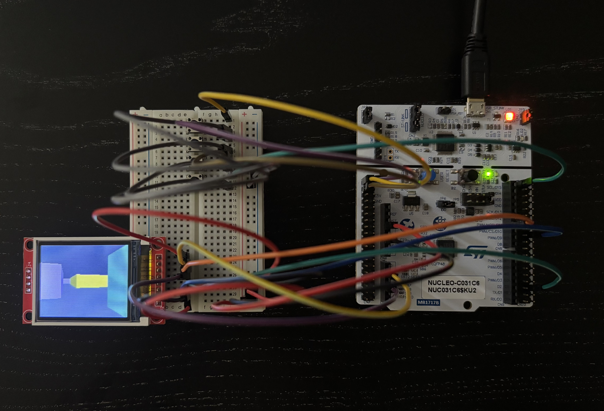

# Embedded DDA Raycaster

A custom embedded 3D raycasting engine built from scratch in C for an STM32 Nucleo microcontroller. The engine uses a fixed-grid map, DDA ray traversal, and fixed-point math to render a real-time pseudo-3D environment on an ST7735 display. It implements player movement, collision detection, camera rotation, directional lighting, and column-based rendering using precomputed lookup tables for efficient performance on hardware without an FPU. I also developed a [desktop version](https://github.com/Leo741776/dda-raycaster) with a crisper image and higher frame rate. I used the STM32 HAL library to configure the display for SPI communication.

## Demo

    
    

## Overview

Designed specifically for microcontroller hardware without a floating-point unit:

- **Fixed-point arithmetic** - Q16.16 math replaces floating-point operations for efficient integer-based calculations.
- **Precomputed trigonometric tables** - Sine/cosine lookup tables eliminate expensive runtime trigonometric calculations.
- **Column-based rendering** - Column-based rendering minimizes SPI communication overhead with the ST7735 display.

### Modular Architecture

- **main.c / main.h** - Hardware initialization, application loop, input polling, and system integration.
- **dda.c / dda.h** - Digital Differential Analysis raycasting algorithm, ray traversal, wall detection, and projection calculations.
- **player.c / player.h** - Player position management, fixed-point movement, collision detection, and camera rotation.
- **map.c / map.h** - Fixed-grid world layout.
- **draw.c / draw.h** - Rendering pipeline, wall color selection, ceiling/floor drawing, and directional shading.
- **st7735.c / st7735.h** - ST7735 display driver, SPI communication, and optimized column output.
- **fixed_point.h** - Q16.16 arithmetic utilities for integer-based calculations.
- **trig_table.c / trig_table.h** - Precomputed trigonometric values for fast rotation calculations.
- **controls.h** - GPIO button definitions and input state handling.
